# BukaToko: User Behaviour & Funnel Analysis

End-to-end analysis of **10,000 e-commerce user events** (27 Mar – 23 Sep 2025) for a fictional marketplace, BukaToko.
The project cleans the raw event log, answers four business questions with **Python (pandas, matplotlib)**, adds a conversion-funnel view, and turns the findings into a **16-slide presentation** with recommendations and a 90-day roadmap.

> Case study for the *Python for Data Analyst* course by **Andika Pratama Zaid**.

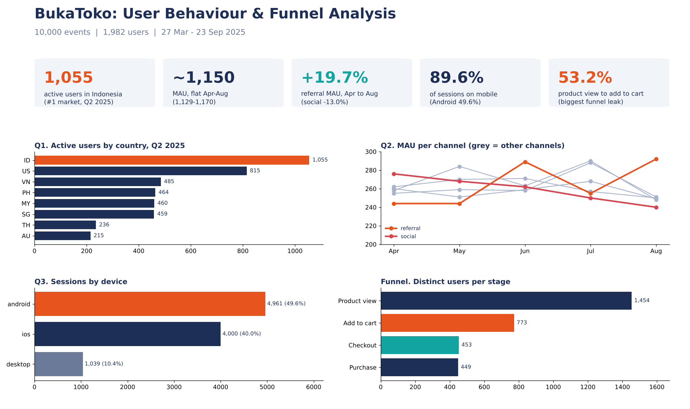

## Key findings

| # | Question | Answer |
|---|----------|--------|
| Q1 | Which country has the most active users in Q2 2025? | **Indonesia**: 1,055 distinct users (of 1,848), ahead of the US (815). ID + US = 44.7% of country activity |
| Q2 | How is MAU trending per channel? | **Flat** at 1,129–1,170 per month (Apr–Aug). Referral is the only grower (+19.7%), social falls the most (−13.0%) |
| Q3 | Which device is used most (by session)? | **Android**: 4,961 of 10,000 sessions (49.6%). Mobile is 89.6% of sessions |
| Q4 | What % of searchers add to cart the same day? | **0.13%** (1 of 750). 38.1% add to cart on a different day, so same-day attribution understates search |
| + | Where does the funnel leak? | Product view → add to cart converts only **53.2%**. Checkout → purchase is 99.1% |

**Takeaway:** growth is stalled around 1,150 MAU, so the lever is conversion and retention rather than more acquisition spend. Indonesia is the core market, referral is the growth signal, and the cart gap is the first fix worth testing.

## Results

### Q1. Indonesia leads Q2 2025 active users
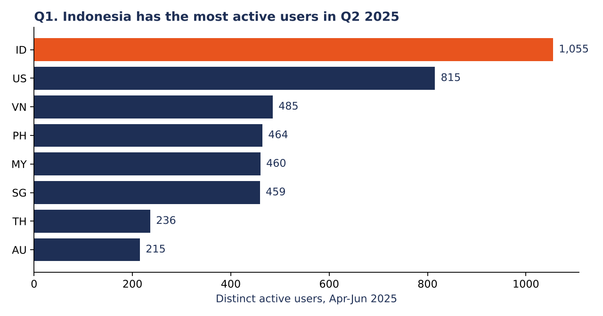

### Q2. MAU is flat; referral grows, social declines
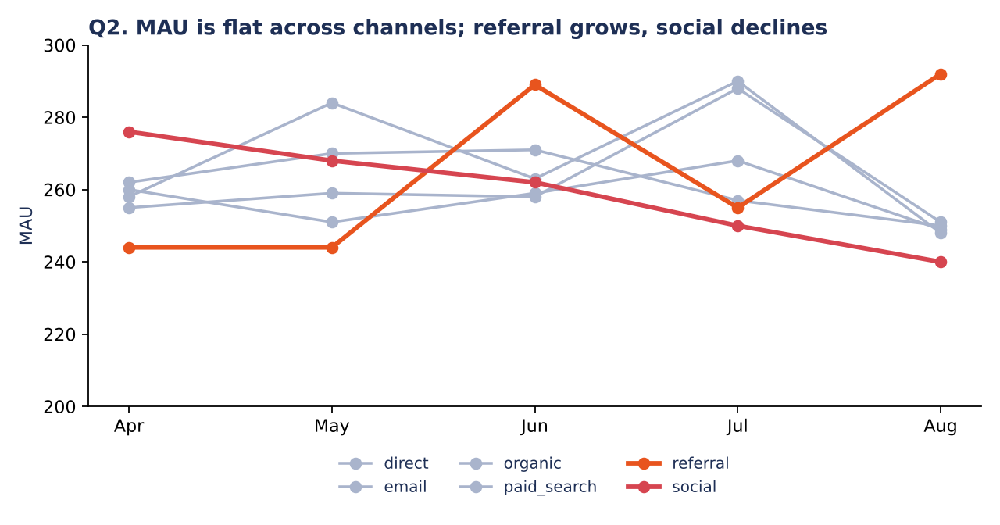

### Q3. Android is the most used device
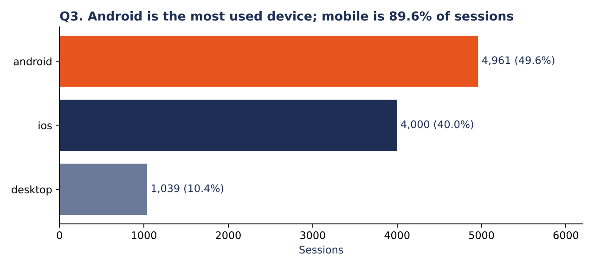

### Q4. Same-day search to add-to-cart is almost zero
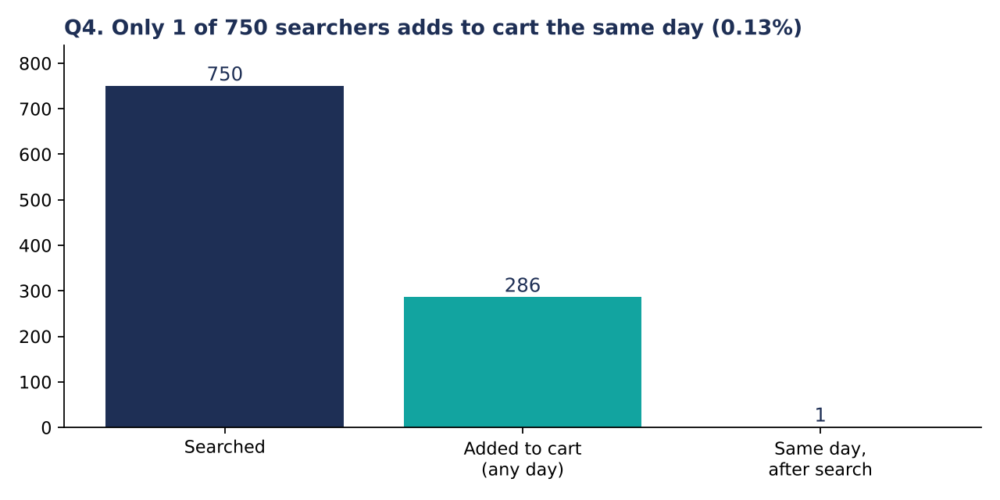

### Added: the conversion funnel
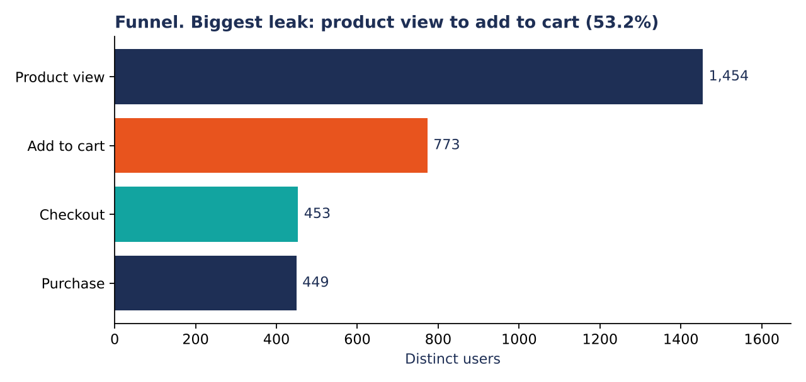

## Presentation

Full deck: [`deck/BukaToko_Case_Study.pdf`](deck/BukaToko_Case_Study.pdf) (editable version: [`.pptx`](deck/BukaToko_Case_Study.pptx), charts are native and editable).

All 16 slides:

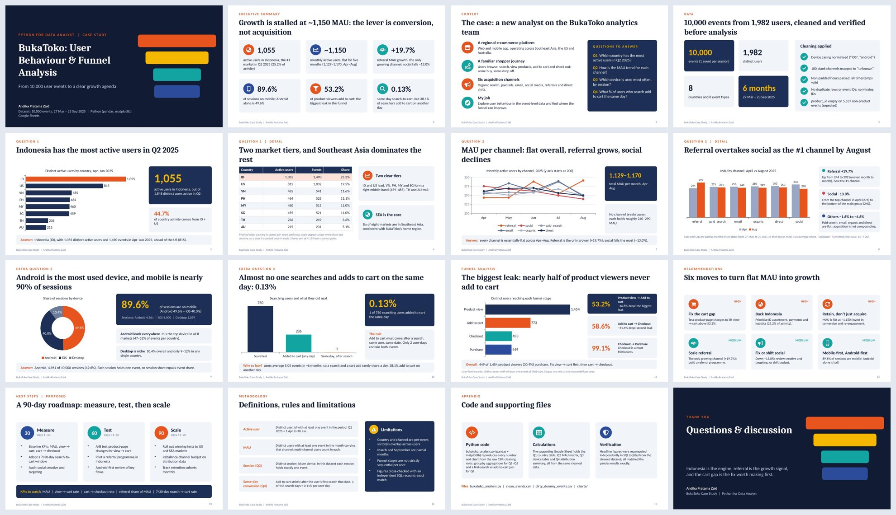

Highlights:

| Executive summary | Q1: country | Q2: channel MAU |
|---|---|---|
| 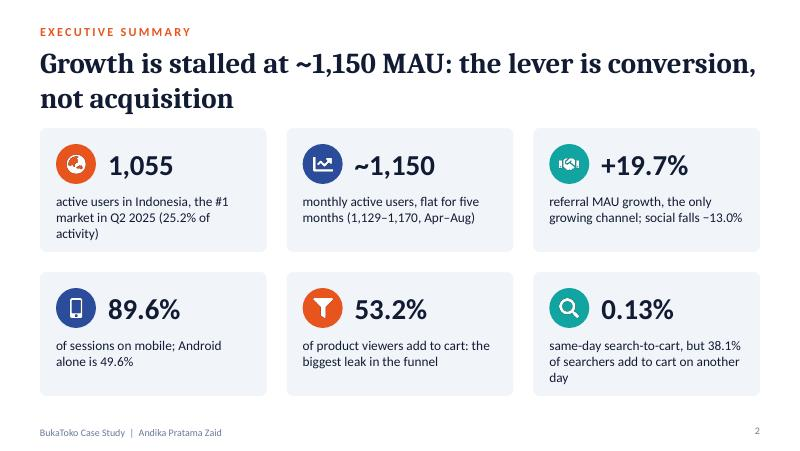 | 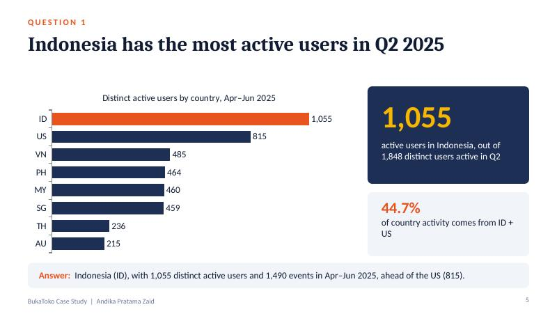 | 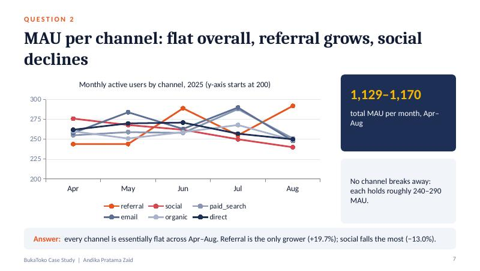 |

| Funnel analysis | Recommendations |
|---|---|
| 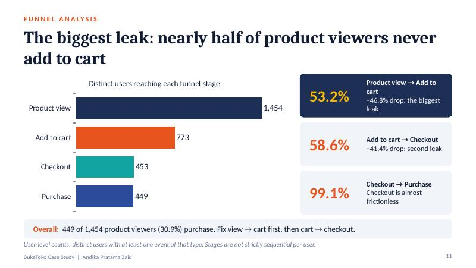 | 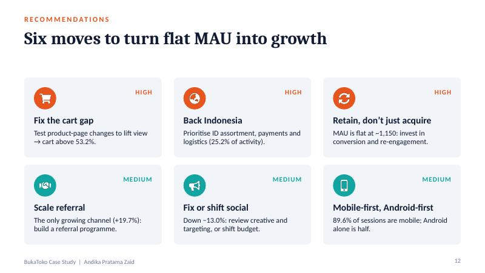 |

## Repository structure

```
.
├── data/
│   ├── raw/dirty_dummy_events.csv   # raw event log (10,000 rows)
│   └── clean_events.csv             # cleaned output (generated)
├── src/bukatoko_analysis.py         # cleaning, Q1-Q4, funnel, charts
├── charts/                          # dashboard + PNG charts (generated)
├── deck/
│   ├── BukaToko_Case_Study.pptx / .pdf
│   ├── preview/                     # slide images used in this README
│   └── source/build_deck.js         # script that builds the deck (pptxgenjs)
├── requirements.txt
└── README.md
```

## How to run

```bash
pip install -r requirements.txt
python src/bukatoko_analysis.py
```

The script prints every figure used in the deck, writes `data/clean_events.csv`, and saves the charts to `charts/`.

<details>
<summary>Rebuild the deck (optional, Node.js)</summary>

```bash
cd deck/source
npm install pptxgenjs react react-dom react-icons sharp
node build_deck.js
```
</details>

## Method

- **Cleaning:** device casing normalised to lowercase; 100 blank channels mapped to `unknown`; non-padded hours parsed (all 10,000 timestamps valid); no duplicate rows or event IDs, no missing user/session IDs.
- **Active user:** distinct `user_id` with at least one event in the period (Q2 2025 = 1 Apr – 30 Jun).
- **MAU:** distinct users with at least one event in the month carrying that channel. March and September are partial months and are excluded from the trend.
- **Same-day conversion (Q4):** `add_to_cart` strictly after the user's first `search` on the same calendar date.
- **Funnel:** distinct users with at least one event of each stage.
- **Verification:** headline figures were cross-checked with an independent SQL recount and matched exactly.

## Limitations

- `country` and `channel` are per-event attributes, so a user can appear under several; country and channel totals overlap.
- Every `session_id` holds exactly one event, so session share equals event share.
- Funnel stages are not strictly sequential per user (user-level counts).
- The dataset is synthetic ("dummy"), so the findings illustrate the analytical approach rather than real BukaToko performance.

## Tech stack

Python · pandas · matplotlib · pptxgenjs (deck) · Google Sheets (supporting calculations)

## License

Code is released under the MIT License (see `LICENSE`).
